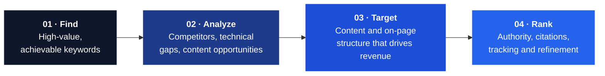

**Content-first SEO. Technical precision. Visibility on Google and in AI-generated answers.**

 

 

 

[**Overview**](#overview) &nbsp;·&nbsp; [**Services**](#services) &nbsp;·&nbsp; [**Results**](#selected-results) &nbsp;·&nbsp; [**Engagement Options**](#engagement-options) &nbsp;·&nbsp; [**Process**](#process) &nbsp;·&nbsp; [**FAQ**](#frequently-asked-questions) &nbsp;·&nbsp; [**Contact**](#contact)

 

## Overview

Sakib Sarker is an SEO consultant based in Dhaka, Bangladesh, serving clients worldwide. Since 2019 he has delivered **more than 2,000 SEO and content projects**, the majority as long-term retainers.

The methodology is **content-first**: search intent and content quality come first, followed by the technical, structural, and off-page work needed to rank and to stay ranked. Generative Engine Optimization (GEO) and Answer Engine Optimization (AEO) are included in every engagement, so content is discoverable on Google and citable by AI assistants such as ChatGPT, Gemini, and Perplexity.

> [!NOTE]
> All work is performed directly by Sakib. There are no account managers, no outsourced writers, and no opaque reporting.

<table>
  <tr>
    <td align="center" width="25%"><h3>7+</h3>YEARS OF EXPERIENCE</td>
    <td align="center" width="25%"><h3>2,000+</h3>PROJECTS DELIVERED</td>
    <td align="center" width="25%"><h3>5</h3>PLATFORMS COVERED</td>
    <td align="center" width="25%"><h3>100%</h3>WHITE-HAT PRACTICES</td>
  </tr>
</table>

 

## Services

### Core SEO

| Service | Scope |
|:--|:--|
| **Keyword Research & Competitor Analysis** | Search-intent mapping across informational, commercial, and transactional queries; difficulty-based prioritization; competitor content-gap reporting. |
| **Technical SEO** | Crawlability and indexation, Core Web Vitals, mobile usability, canonicalization, XML sitemaps, duplicate content, broken internal links, structured data validation. |
| **On-Page & Content SEO** | Title and meta optimization, header structure, internal linking, content clusters, topical authority, and scheduled content refreshes. |
| **Off-Page SEO & Link Building** | Relevance-led outreach, digital PR, brand mentions, and citations, aligned with Google's spam policies. |
| **Local SEO** | Google Business Profile optimization, NAP consistency, citations, review strategy, local landing pages, and Bangla / Banglish / English keyword targeting. |

### Platform Specializations

  
  
  
  
  
  

| Platform | Focus |
|:--|:--|
| **Shopify** | Product and collection page structure, Product and Offer schema, image and speed optimization, third-party app script cleanup. |
| **WordPress / WooCommerce** | Yoast and RankMath configuration, taxonomy cleanup, internal linking, shop and product page fixes. |
| **Webflow** | Semantic structure, CMS collection SEO, metadata templating, URL slug standards, structured data. |
| **Squarespace** | URL and heading structure, image compression, schema injection within template constraints. |
| **Wix** | Platform-specific on-page and technical optimization. |
| **YouTube** | Keyword-mapped titles, timestamped descriptions, chapter markers, tags, and thumbnails optimized for YouTube search and AI video summaries. |

### AI Search

| Service | Scope |
|:--|:--|
| **GEO / AEO** | Answer-first content structure, FAQ and HowTo schema, entity definitions, and consistent brand facts across the web for reliable AI citation. |
| **AI Optimization (AIO)** | AI-readable content, E-E-A-T signals, structured data (FAQ, Article, Organization, Product, Review), technical foundations, and authority building. |

### Recovery

Clean, white-hat rebuilds for sites affected by algorithm updates, toxic backlinks, thin or AI-generated content, or keyword stuffing.

 

## Client Profiles

| Client | Typical objective |
|:--|:--|
| **Ecommerce brands** | Product and collection pages that rank and surface in AI shopping results |
| **Agencies** | White-label or direct SEO subcontracting without in-house hiring |
| **SaaS & service businesses** | High-intent commercial keywords, content depth, and AI citation |
| **Creators & YouTubers** | Video SEO combined with a site that converts search traffic |
| **Local businesses** | Map Pack rankings and Google Business Profile visibility |
| **Penalty recovery** | Rebuilding trust after algorithm or manual-action impact |

 

## Process

Rankings are monitored across Google and AI search surfaces. Each client receives a documented roadmap and a plain-English monthly report covering work completed and its measured effect.

 

## Selected Results

Figures are taken from Google Search Console, Google Analytics 4, and Semrush dashboards. Client names and domains are anonymized.

| Engagement | Outcome |
|:--|:--|
| **Ecommerce** · GA4, year-over-year | Organic users **+90.6%** · sessions **+87.2%** · revenue **+53%** |
| **Keyword rankings** · 12 months | Top 3 keywords **4 → 60** (+1,400%) · positions 4–10 **+1,560%** |
| **Keyword footprint** | Tracked keywords **16 → 958** (+5,887%) |
| **Search Console** · month-over-month | Clicks **+724%** (490 → 4.04K) · impressions **+351%** (39.7K → 179K) |
| **Search Console** · month-over-month | Clicks **+179.7%** (23.6K → 66K) · impressions **+98.4%** (988K → 1.96M) |
| **Large-scale content SEO** | **1.33M clicks** following the start of services |
| **Year-over-year** · Q4 2025 | **1.42M clicks** and 149M impressions vs. 958K clicks and 123M impressions prior year |
| **Local SEO** · Map Pack | Grid rankings moved from predominantly 20+ to **top 3** across the service area |
| **Google Business Profile** | Directions **+34.8%** · interactions **+13.1%** · website clicks **+8.4%** · calls **+6.7%** |
| **New market entry** | Clicks **23 → 118** within three weeks of targeting a new country |
| **Agency transition** | Organic traffic restored and growing after taking over from a previous provider |

> [!IMPORTANT]
> Outcomes depend on site history, competition, and starting position. Durable rankings typically develop over 3–6 months, and no specific position is guaranteed.

 

## Engagement Options

Every engagement is scoped after a short audit so that pricing reflects the work required.

<table>
  <tr>
    <th align="center" width="33%">FOUNDATION Core SEO</th>
    <th align="center" width="33%">GROWTH Platform + Content SEO</th>
    <th align="center" width="33%">FULL-FUNNEL SEO + Off-Page + AI Visibility</th>
  </tr>
  <tr>
    <td align="center"><h3>$300 / month</h3></td>
    <td align="center"><h3>$800 / month</h3></td>
    <td align="center"><h3>$1,500 / month</h3></td>
  </tr>
  <tr>
    <td valign="top">
      ✓ Keyword & competitor research 
      ✓ On-page SEO for key pages 
      ✓ Technical audit + fix list 
      ✓ Search Console setup
    </td>
    <td valign="top">
      <b>Everything in Foundation, plus:</b> 
      ✓ Platform-specific technical fixes 
      ✓ Content structure & optimization 
      ✓ Monthly ranking reports
    </td>
    <td valign="top">
      <b>Everything in Growth, plus:</b> 
      ✓ White-hat backlink building 
      ✓ YouTube video SEO 
      ✓ GEO / AEO for AI search
    </td>
  </tr>
</table>

 

## Working Model

| Criterion | In-house / DIY | Typical agency | Direct engagement |
|:--|:--|:--|:--|
| Access to the specialist | Limited SEO expertise | Account manager intermediary | **Direct, always** |
| Platform-specific fixes | Learned on the job | Varies by team | **Included** |
| Technical audit depth | Surface-level | Varies by retainer | **Full crawl and prioritized fix list** |
| Content strategy | Time-intensive | Frequently outsourced | **Written and structured directly** |
| GEO / AEO | Rarely considered | Seldom offered | **Core deliverable** |
| Reporting | Self-managed | Dashboard, limited context | **Plain-English monthly reports** |
| Cost structure | Internal time | Flat retainer | **Scoped to required work** |

 

## Tools

  
  
  
  
  
  
  
  
  
  
  
  

Tools inform decisions; strategy drives results.

 

## Timeline

| Year | Milestone |
|:--:|:--|
| **2019** | Began freelancing in on-page SEO and keyword research for local businesses |
| **2021** | Expanded into technical audits and multi-platform work (WordPress, Shopify, Webflow) |
| **2023** | Added YouTube video SEO and white-hat backlink and citation building |
| **2025–26** | Integrated GEO/AEO into every engagement as AI search became a primary discovery channel |

 

## Frequently Asked Questions

<b>How long until results are visible?</b>

 
Measurable ranking movement typically appears within 60–90 days, with compounding growth thereafter. Durable rankings generally build over 3–6 months.

<b>Are specific rankings guaranteed?</b>

 
No. Any provider guaranteeing page-one placement within days is relying on high-risk tactics or overstating outcomes.

<b>How does GEO differ from SEO?</b>

 
SEO targets visibility in search results. GEO structures content so AI assistants can understand, trust, and cite it within generated answers.

<b>Are international clients supported?</b>

 
Yes. Clients span the US, UK, UAE, Canada, Australia, and other regions. All communication and reporting is in English.

<b>Is content written in-house?</b>

 
Yes. Every brief and edit is handled directly by Sakib.

<b>Can sites affected by a Google update be recovered?</b>

 
Yes. Recovery begins with an audit and remediation of thin content and low-quality links, followed by a sustainable rebuild.

 

## Contact

To request a free audit, send your website URL and a brief description of your goals.

Dhaka, Bangladesh &nbsp;·&nbsp; Serving clients worldwide &nbsp;·&nbsp; Currently accepting new projects

WhatsApp and Google Business Profile links are available on the website.

 

<b>Privacy Policy</b>

 
Only information that a visitor chooses to share directly (for example, by email or WhatsApp) is collected. No personal data is sold or shared with third parties. Aggregated, privacy-respecting analytics may be used to improve the site and are not used to identify individual visitors. Information submitted through contact channels is used solely to respond to the inquiry. To request deletion of submitted information, contact <a href="mailto:asakibsarker@gmail.com">asakibsarker@gmail.com</a>.

© 2026 Sakib Sarker · SEO & AI Search Consultant · Bangladesh

